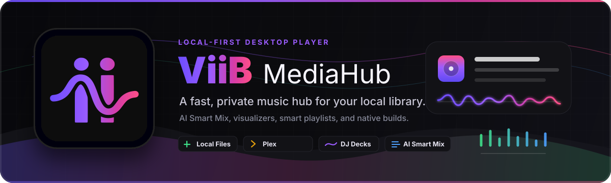
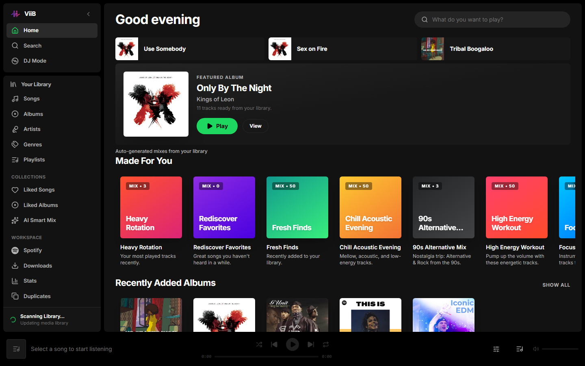
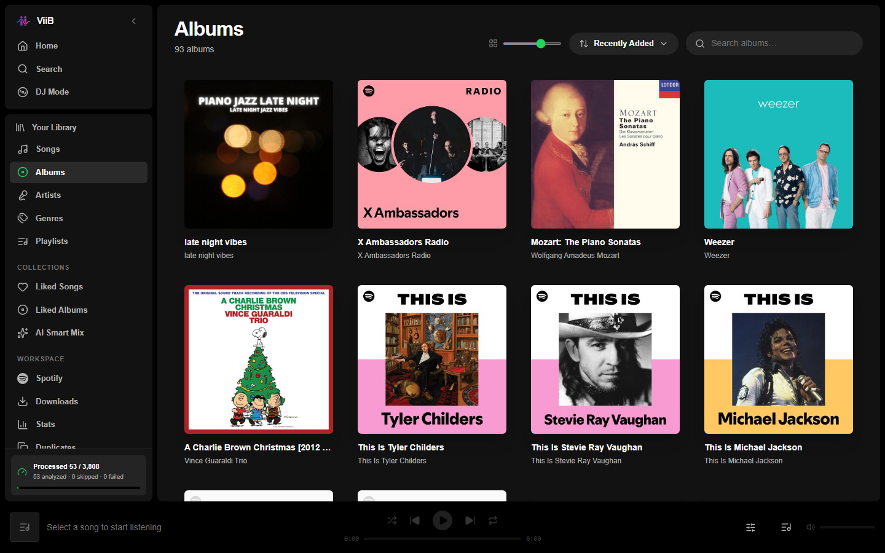
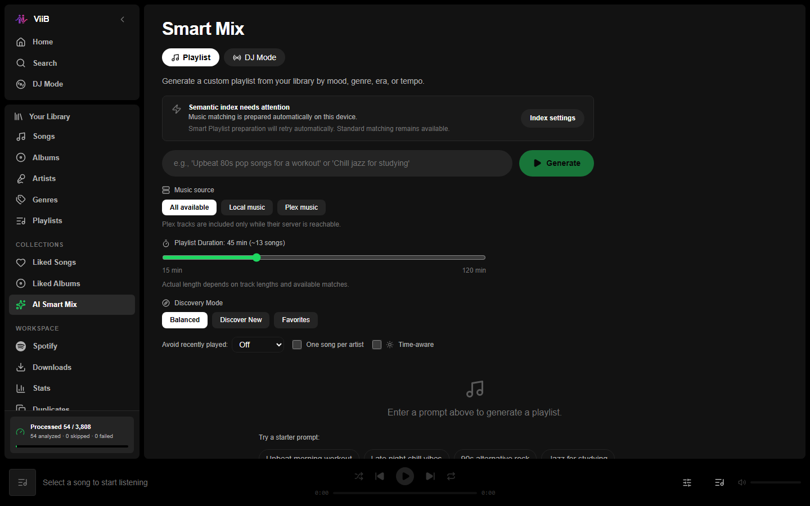
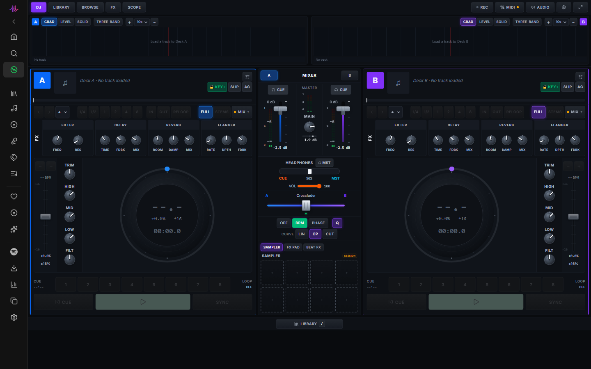
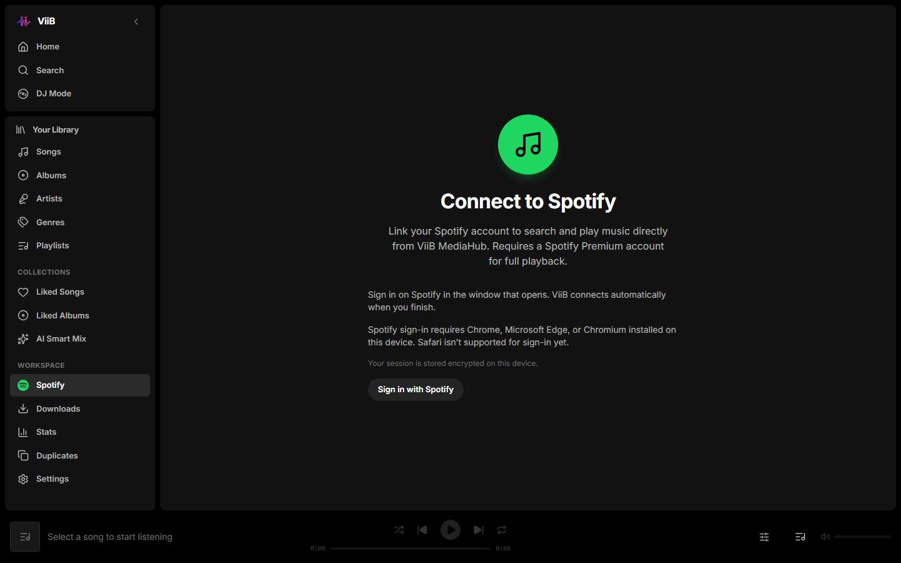

<p align="center">
  
</p>

<p align="center">
  <strong>Your music. Your mood. Your mix.</strong><br/>
  A local-first music hub that turns your collection into a place to discover, listen, and DJ.
</p>

<p align="center">
  <a href="https://github.com/ajbergh/ViiB-MediaHub/releases">Download</a> ·
  <a href="#the-tour">Take the tour</a> ·
  <a href="#features">Features</a> ·
  <a href="#quick-start">Get started</a> ·
  <a href="docs/index.md">Documentation</a>
</p>



## Meet your next favorite way to listen

Bring your local files and Plex music together in one library. Rediscover forgotten favorites, browse a wall of album art, or describe a mood and let AI Smart Mix build the soundtrack. When you want to take the controls, step into a two-deck DJ workspace with waveforms, effects, hot cues, and headphone monitoring.

ViiB runs on your own computer, as a native desktop app or a local server in your browser. Your catalog, playlists, likes, and listening history live locally. Spotify and your choice of AI provider add optional ways to explore and create.

## Features

| Make it yours | What you can do |
|---|---|
| **One collection, every angle** | Browse local folders and synchronized Plex music through the same Songs, Albums, Artists, Genres, search, playlists, and queue. |
| **A home for your listening** | Choose Music Shelves, Cover Wall, or Compact Dashboard; jump into favorites, recent additions, and personalized Smart Mixes. |
| **Say the vibe** | Ask AI Smart Mix for a playlist or a phased DJ set. Add duration, era, artist, mood, and supported audio constraints. |
| **Matching that stays local** | Meaning-based catalog search prepares automatically on your device. Switch AI providers without rebuilding the library index. |
| **Take the decks** | Mix with two decks, waveforms, pitch/tempo controls, loops, hot cues, effects, a sampler, and separate main/cue outputs where supported. |
| **Shape the sound** | Gapless playback, configurable crossfade, a 10-band EQ with presets and Auto-EQ, visualizers, and a sleep timer. |
| **Explore Spotify** | Sign in, search, and browse saved albums, artists, and playlists. Spotify Premium enables streaming, playback queue actions, and downloads. |
| **Keep your library in shape** | Monitor folders, review duplicates, enrich metadata, prepare track analysis, and run diagnostics, repair, backup, or staged restore. |
| **See your listening story** | Track listening time, play counts, top artists/albums/genres, likes, and history; add optional Last.FM metadata and scrobbling. |

### AI with a local foundation

Try a request like **“45 minutes of instrumental jazz between 90 and 110 BPM, building gradually”** or **“90s alternative rock for a late-night drive.”** ViiB selects from your existing local/Plex catalog and applies source, duration, diversity, and supported audio requirements. Missing measurements remain unknown; limited matches can produce a shorter playlist.

Local matching downloads about **31 MB** of verified model files once, then indexes and searches offline. Your selected AI provider handles playlist reasoning and enrichment separately: cloud AI can receive your prompt and bounded candidate metadata. Choose Gemini, OpenAI, Anthropic, OpenRouter, Ollama, or X.AI where configured. See [AI Smart Mix](docs/smart-playlists.md) for behavior and privacy details.

## The tour

### A collection worth getting lost in

Album artwork, quick navigation, and one catalog for local files and Plex music. Build playlists and keep your favorites close without switching between separate source libraries.



### From a few words to a whole mood

Choose Playlist or DJ Mode, describe what you want to hear, and set a target duration. Home's Smart Mixes offer another way back into your collection using metadata and listening history.



### Your collection, behind the decks

A dedicated performance workspace with blue and purple decks, a central mixer, effects, cue controls, and a library drawer. Load pre-generated `.viibstems` packages from adjacent folders or separate Stem Libraries.



DJ Mode requires a desktop viewport at least **1440 CSS pixels wide**. MIDI and separate output routing depend on browser/device support. Track analysis and cue suggestions are advisory; professional accuracy and calibration gates remain open. ViiB plays stem packages; it does not generate stems. [Explore DJ Mode →](docs/dj-mode.md)

### More ways to explore

Browse Spotify in its own workspace, then follow downloads and scan completed files into your local library. Free or unknown-plan sessions can browse; Premium is required for streaming and downloads. Local playback works independently of Spotify Premium.



Screenshots were captured from the live app at 1440 × 900. Artwork, counts, account state, and analysis progress reflect the capture library.

## Quick Start

1. **Get ViiB:** choose a package for your platform from [Releases](https://github.com/ajbergh/ViiB-MediaHub/releases). Browser builds include the frontend; unzip and run the included executable.
2. **Bring your music:** add folders in **Settings → Library Sources**, or connect a Plex server, choose a music library, and synchronize it.
3. **Press play:** explore Home, search your collection, or open AI Smart Mix after configuring an AI provider in **Settings → AI & Enrichment**.

Plex support is for **music/audio libraries**. Plex must be reachable for remote playback; cached metadata remains browsable during temporary outages. Spotify sign-in requires Chrome, Edge, or Chromium installed on the backend device. See the [Plex](docs/plex-music.md) and [Spotify](docs/spotify.md) guides for setup.

### Platforms

| Platform | Architecture | Desktop release | Browser release |
|---|---|:---:|:---:|
| Windows | x64 | ✓ | ✓ |
| Windows | ARM64 | — | ✓ |
| macOS | Apple Silicon | ✓ | ✓ |
| macOS | Intel | ✓ | ✓ |
| Linux | x64 | ✓ | ✓ |
| Linux | ARM64 | — | ✓ |

Desktop releases use Wails; browser releases serve the same interface from a local Go executable. Linux browser builds need Ayatana AppIndicator for the system tray, or can run with `-no-tray`.

### Run from source

Use **Node.js 24.15.0+** (recommended; CI uses Node 24) or **Node.js 22.22.2+**, and **Go 1.26.9+**. From the repository root:

```bash
npm ci
```

Start the backend in one terminal:

```bash
cd backend
go run ./cmd/viib -port 8080 -no-browser
```

Start the UI in another terminal, from the repository root:

```bash
npm run dev
```

Open **http://localhost:3000/**. For native dependencies, Windows launch scripts, packaging, and validation commands, see [Development and builds](docs/development.md).

## Documentation

Start with the [documentation hub](docs/index.md), or jump to a workflow:

- [Player, queue, EQ, and Now Playing](docs/player.md)
- [AI Smart Mix and generated DJ sets](docs/smart-playlists.md)
- [Two-deck DJ Mode](docs/dj-mode.md)
- [Plex music](docs/plex-music.md) and [Spotify](docs/spotify.md)
- [Settings](docs/settings.md) and [Library Operations](docs/library-operations.md)
- [Keyboard shortcuts](docs/keyboard-shortcuts.md)
- [Roadmap and release gates](docs/ROADMAP.md)

## Architecture

React 19, TypeScript, Vite, Zustand, and Tailwind power the interface. Go, SQLite, and Wails handle the local service, catalog, and desktop shell. Local files and Plex music share one catalog and playback contract. [Read the architecture guide](docs/architecture.md).

## API

The backend exposes REST and SSE endpoints, with a versioned surface for library synchronization, search, durable jobs, and source management. The [OpenAPI v2 reference](docs/openapi-v2.yaml) covers core routes; additional analysis routes currently use their backend handler contracts. See [developer API notes](docs/development.md#api).

## Data and security

Application data lives in your OS user configuration directory under `ViiB-MediaHub/`. Sensitive integration settings use machine-bound encryption; Plex media credentials stay on the backend. New backups exclude Spotify sign-in credentials; other integration credentials may remain, so protect backup archives. [Data and security details](docs/development.md#data-and-security).

## Validation

CI checks frontend types, tests, and builds; Go tests, race tests, vet, and Staticcheck; platform packaging; and dependency/binary vulnerabilities. Dated provider and analysis evidence, including remaining release gates, lives in the [maintainer references](docs/index.md#maintainer-and-reference-documentation). [Run the checks locally](docs/development.md#normal-validation).

## Contributing

Issues and pull requests are welcome. Start with the [development guide](docs/development.md) and keep changes aligned with the shared catalog and playback architecture.

## License

MIT. Song BPM and key data provided by [GetSongBPM](https://getsongbpm.com/).
