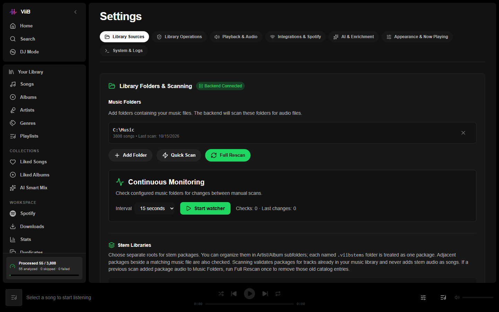

# Settings

The Settings page provides full configuration for all aspects of ViiB MediaHub.

---

## Sections

| Section | Purpose |
|---|---|
| [Library Sources](#library-sources) | Local folders, scans, monitoring, Plex, maintenance, and reset |
| [Library Operations](#library-operations) | Track analysis, metadata operations, diagnostics, repair, and backup/restore |
| [Playback & Audio](#playback--audio) | Crossfade, gapless, normalization, EQ, and output routing |
| [Integrations & Spotify](#integrations--spotify) | Downloads, conversion, Spotify, and Last.FM |
| [AI & Enrichment](#ai--enrichment) | AI provider, semantic retrieval, and metadata enrichment |
| [Appearance & Now Playing](#appearance--now-playing) | Home layout, Smart Mix visibility, and player presentation |
| [System & Logs](#system--logs) | System information, support tools, and the in-app debug log |

---

## Library Sources

The Library Sources tab includes a backend connection status indicator. A green indicator means the API is reachable; a warning indicator means the frontend is running without an available Go backend.

### Scan Folders

Lists all local music directories ViiB MediaHub monitors. Each folder has:
- **Path** — directory path
- **Remove** button — stop watching this folder

To add a folder click **Add Folder** and use the in-app folder browser. On Windows it starts at the available drives; select a drive or folder to navigate, then choose **Add This Folder** to add the current path. **Cancel** or the close button exits without changing the configured folders.

Continuous monitoring is configured directly below local folder scanning. It checks configured folders for changes between manual scans; choose 5 seconds, 15 seconds, 30 seconds, 1 minute, or 5 minutes.

### Stem Libraries

Use **Add Stem Library** to configure separate roots for pre-generated stem packages, then **Scan Stem Libraries** to validate and associate packages with tracks already in your music library. Artist/Album subfolders are supported; each named `.viibstems` folder is one package. Adjacent packages beside a matching music file are also checked. After a successful startup catalog check, ViiB queues a background scan of enabled Stem Libraries. Use **Scan Stem Libraries** to request a manual refresh after adding or changing packages; this does not import their component audio as songs.

Stem audio is not added as separate songs. If an older scan added package audio under Music Folders, run **Full Rescan** once to remove those catalog entries. ViiB consumes packages; it does not generate stems. See the [stem package contract](VIIB_STEM_PACKAGE_V1.md) and [DJ Mode](dj-mode.md#stem-packages).

### Plex Media Server music

Open **Settings → Library Sources → Plex Media Server** to configure Plex as a remote music source. The Plex panel supports:

- bounded automatic LAN discovery through Plex GDM;
- manual hostname, IP, HTTP, or HTTPS server configuration;
- Plex-hosted sign-in/reconnect for claimed servers;
- music/audio-library selection;
- explicit synchronization/resynchronization;
- offline/authentication-required status;
- changing or removing the Plex source without modifying anything on the Plex server.

Plex songs synchronize into the same ViiB catalog used by local files, so they appear in the existing Songs, Albums, Artists, Search, queue, playlists, likes, history, Smart Mixes, AI Smart Mix, and statistics experiences. Plex video libraries are not supported.

The Plex panel also includes an optional **AI Metadata Writeback** workflow. AI enrichment is always local first: preview the per-track genre/year changes, explicitly approve the exact diff, then ViiB writes and locks only those fields in Plex and verifies them. It never writes audio-file tags; mood/energy/tempo/BPM and semantic embeddings remain ViiB-only. The Plex token must have PMS metadata-management permission.

See [Plex Media Server Music Support](plex-music.md) for setup, authentication/security, synchronization behavior, playback details, and troubleshooting.

### Scan Now

Triggers an immediate incremental scan of all configured local folders. Progress is streamed through the library event path and reflected in the app's status surfaces. Plex synchronization is a separate explicit operation in the Plex source panel.

### Reset Library

**Destructive to ViiB's local catalog state.** Removes catalog data from the ViiB database, then re-scans configured local folders. It does not delete source media. Use Library Operations diagnostics/repair before resetting the library when possible.

## Library Operations

The [Library Operations](library-operations.md) tab prepares tracks for DJ features and handles metadata operations, diagnostics, repair, validated backups, and staged restore. Track analysis supports local files and available Plex tracks; **Prepare new tracks automatically** is on by default for local scans, while Plex preparation is explicit.

See [Library Operations](library-operations.md#track-analysis) for the analysis workflow and recovery details.

---

## Appearance & Now Playing

Controls how the [Home](home.md) page is presented.

| Setting | Description |
|---|---|
| Home Layout | Choose **Music Shelves**, **Cover Wall**, or **Compact Dashboard** |
| Show Smart Mixes | Show or hide auto-generated Smart Mix sections on Home |
| Now Playing visuals | Visualizer mode, artwork opacity, fullscreen background, and fullscreen opacity |

Home layout choices persist across reloads.

---

## Playback & Audio

| Setting | Description |
|---|---|
| Crossfade | Duration (0–12 s) of the fade between tracks |
| Gapless Playback | Pre-load next track to eliminate silence between songs |
| Volume Normalization | Adjust playback level so all tracks sound similar |
| Equalizer | Toggle the 10-band EQ panel |

---

### Audio Output Devices

Configures separate audio devices for DJ use:

- **Main Output** — speakers or PA system
- **Headphone / Cue Output** — DJ headphones for previewing tracks without the audience hearing

Device routing uses the Web Audio API's `setSinkId`. Devices are listed after the browser grants audio permission.

---

## Integrations & Spotify

| Setting | Description |
|---|---|
| Spotify account | Sign in through Spotify in Chrome/Edge/Chromium, switch accounts, cancel a pending sign-in, or disconnect |
| Download Location | Folder where downloaded OGG files are saved |
| Concurrent Downloads | How many simultaneous downloads are allowed (1–10, default 3) |
| Quick Scan After Downloads | Number of completed downloads before an automatic quick scan; 0 disables it |
| MP3 Conversion | Optional Ogg-to-MP3 conversion and worker count |

Normal Spotify sign-in requires an installed Chrome, Microsoft Edge, or Chromium browser and a reachable Go backend. Enter credentials on Spotify’s own page; ViiB captures and stores the validated session encrypted on this device. No Developer app or cookie-paste field is required. See [Spotify Integration](spotify.md) for sign-in, session expiry, and current parity limitations.

### Last.FM Integration

| Setting | Description |
|---|---|
| API Key | From your Last.FM developer account |
| Shared Secret | From your Last.FM developer account |
| Test Connection | Verifies the key is valid |
| Scrobbling | Enable scrobbling with your Last.FM username and password |

Last.FM provides community-sourced genre and tag metadata for tracks, artists, and albums.

---

## AI & Enrichment

### AI Provider

Select and configure the LLM backend used for:
- Genre enrichment
- Mood / energy / tempo analysis
- Smart playlist generation
- AI Smart Mix set building

| Provider | Notes |
|---|---|
| Google Gemini | Requires Gemini API key |
| OpenAI | Requires OpenAI API key |
| Anthropic | Requires Anthropic API key |
| OpenRouter | Requires an OpenRouter API key; available text models are loaded into the model dropdown after saving the key |
| Ollama | Local model; set the model name and endpoint URL |
| X.AI (Grok) | Requires X.AI API key |

Enter the API key (or endpoint for Ollama) and click **Save**.

### Semantic Retrieval Index

The **Smart Playlist Library** panel prepares meaning-based music matching automatically on this device. Its fixed local Model2Vec model is independent of your AI provider; changing the chat model does not require reindexing. No embedding API key, Python, GPU, or Ollama embedding installation is required.

Initial setup downloads about 31 MB of verified public model files. After setup, indexing and semantic search work offline. Catalog content is not sent to an embedding service. Your selected AI provider handles playlist reasoning separately; cloud AI can receive the prompt and bounded candidate metadata, including catalog IDs.

| Control or status | Description |
|---|---|
| Preparation status | Shows model/index readiness, progress, document counts, and errors. |
| Rebuild Index | Rebuilds matching data in the background. |
| Retry Errors | Retries failed preparation/indexing work. |

Ordinary playback remains available while preparation runs. Standard metadata matching remains available when semantic retrieval is unavailable; strict numeric AI requests report the limitation rather than bypassing requirements. See [AI Smart Mix](smart-playlists.md#semantic-retrieval) and [Architecture](architecture.md#semantic-retrieval-subsystem).

### Metadata enrichment source

Choose AI, Last.FM, or Hybrid as the source used for automatic metadata enrichment during library scans. The Library Operations tab provides the **Unified AI Enrichment** action for a full run across genres, mood, energy, tempo, BPM, and release year.

- Progress is shown in the Library Operations status panel and the in-app log when events are emitted.
- Genres are written to the `songs.genre` column in SQLite. For Plex-backed tracks, a separate explicit AI Metadata Writeback preview can later send approved genre changes to Plex; no source audio file tags are modified.

### Unified AI Enrichment

Runs full metadata enrichment: genres, mood, energy, tempo, BPM, and release year.

- Click **Run Unified Enrichment** to start.
- This is slower than genre-only enrichment but produces richer data for AI Smart Mix.

---

## System & Logs

A scrollable in-app event log containing events recorded by the frontend and backend-facing workflows:
- Library scan progress
- Plex source/synchronization activity
- Enrichment status
- Download events
- API errors

Click **Clear** to remove entries from the in-app log, which is in memory. Backend `viib.log` and scanner/analysis `scan.log` are separate files in the application data directory and append across restarts; clearing the in-app view does not clear those files.

Support exports use the [allowlisted support-bundle format](support-bundles.md);
unknown log entries and free-form messages are omitted. Raw local/debug logs
can still contain private details.
