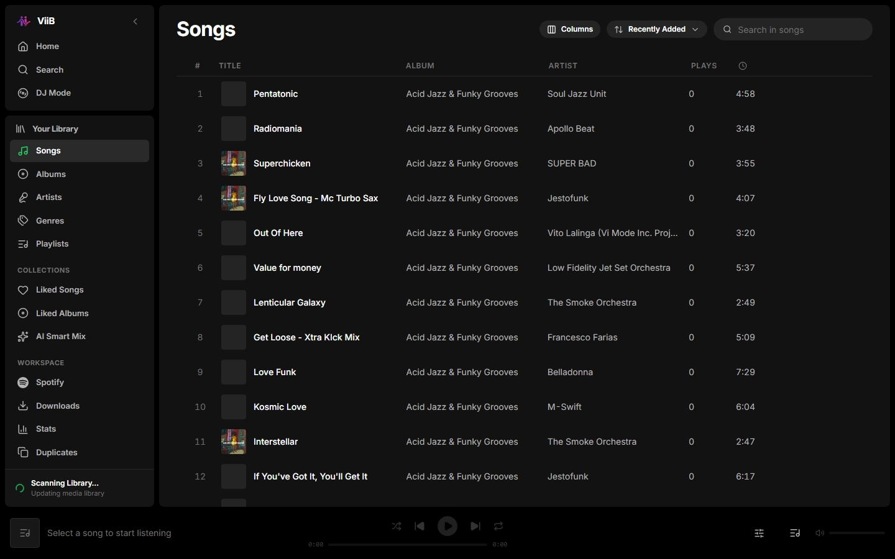

# Songs

The Songs page shows the canonical ViiB track catalog. It is source-transparent: local filesystem tracks and successfully synchronized Plex music tracks appear in the same list and use the same queue, playlist, like, history, and playback interactions.

---

## Features

| Feature | Description |
|---|---|
| Virtualized list | Keeps large libraries responsive without rendering every row at once |
| Sort options | Title, artist, album, duration, play activity, and recently added options where exposed by the UI |
| Filter bar | Filters visible catalog tracks |
| Play All / Shuffle All | Build playback from the current visible/sorted set |
| Context menu | Play, Play Next, Add to Queue, playlist, like, album, and artist actions |
| Like button | Stores the like in ViiB regardless of source |
| Artwork | Local artwork or backend-proxied Plex artwork with fallback handling |

---

## Music sources

### Track release dates

Track properties distinguish **Original release** from **Edition release** and show each date's source. Decade and year matching prefer the original year; an edition year remains the fallback when the original is unknown. Dates retain their available precision, including year-only values.

Scans collect `DATE` separately from `ORIGINALDATE`, `ORIGINALYEAR`, and equivalent original-date tags. Spotify downloads retain the selected album edition's release date; that date is not treated as proof of the recording's original release.

Existing tracks are backfilled automatically in small background batches. MusicBrainz provides original dates only when title, artist, duration, and recording identity match unambiguously. Requests are rate limited and unsuccessful attempts are cached for retry. This lookup requires internet access and sends the track title and artist to MusicBrainz; cached dates remain local and work offline. No API key or model choice is required. Large libraries are enriched gradually.

Manual year corrections take priority. Verified dates survive rescans and cannot be replaced by AI enrichment. AI-derived years remain labeled **AI estimate**; unmatched or ambiguous recordings retain their existing metadata rather than receiving an invented date.

### Local tracks

Local songs are created by scanning configured folders. Their ViiB catalog rows retain filesystem identity so local playback and local-library diagnostics can operate normally.

### Plex tracks

Plex tracks are imported by synchronizing the selected PMS music library. ViiB stores normalized song metadata plus Plex source identity separately, including the PMS machine/library/track/media identifiers required for future synchronization and playback.

The UI does not need a Plex-specific Song type. Plex tracks use normal ViiB song IDs and the existing `/api/audio/{songId}` and `/api/cover/{songId}` routes.

A temporarily offline Plex server does not remove already synchronized songs from the catalog. Playback can fail with a source-unavailable or reconnect/authentication state until PMS becomes reachable again.

---

## Context Menu Actions

Right-click a catalog track to use the normal supported actions, including:

- **Play**
- **Play Next**
- **Add to Queue**
- **Add to Playlist**
- **Like / Unlike**
- **Go to Album**
- **Go to Artist**

These actions are ViiB operations. They do not rename, move, delete, or rewrite a Plex source file.

---

## Recently Added

For local media, the added date comes from ViiB's scan/catalog ingestion. For Plex media, ViiB maps the available PMS `addedAt` metadata during synchronization. This allows source-transparent recently-added sorting without filesystem access to the Plex host.

---

## Empty library

If the ViiB catalog is empty, configure at least one music source:

- add a local folder in [Settings](settings.md), or
- connect and synchronize Plex in [Settings → Library Sources → Plex Media Server](settings.md#plex-media-server-music).
