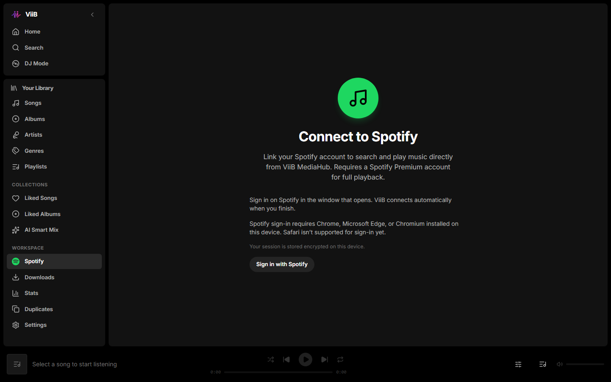

# Spotify Integration

> Current scope reviewed on 2026-10-23: the metadata implementation from PR #117 is merged. Provider parity, native-host qualification and professional local-analysis accuracy remain separate open gates. Historical branch handoffs are preserved in the [metadata foundation archive](archive/spotify-metadata-foundation/README.md).

The Spotify page connects ViiB to your Spotify account for browsing, streaming, and downloads. Spotify browsing is separate from the local/Plex catalog; downloaded media becomes part of that catalog after scanning.

## Connect your Spotify account

Open **Spotify** or **Settings → Integrations & Spotify → Spotify account**. Choose a connection based on the features you need.

| Connection | Availability | Features |
|---|---|---|
| Default browser | Wails desktop, including Safari on Mac | Spotify Web API catalog, library, top tracks, top artists, and Connect device and queue views, subject to Spotify app and account access |
| Web Player | Desktop and browser/server builds with Chrome, Edge, or Chromium on the backend device | Catalog, supported library views, Web Player Recents, and ViiB streaming and downloads with verified Premium |

### Default-browser sign-in on desktop

1. Select **Sign in with your default browser**. If the release includes a Spotify Client ID, Spotify authorization opens immediately.
2. To use your own Spotify Developer app, add the redirect URI shown in ViiB to the app in the [Spotify Developer Dashboard](https://developer.spotify.com/dashboard). The default is `http://127.0.0.1:34115/callback`. If you start ViiB with a different `-port`, register the exact URI shown. Add your Spotify account to the app's allowed users when using Development Mode.
3. Enter the app's **Spotify Client ID** and select **Open Spotify authorization**. Builds with a bundled Client ID also offer **Use your own Spotify Client ID**.
4. Approve access on Spotify's page. When the browser confirms the connection, close the tab and return to ViiB.

The desktop flow uses Spotify's Authorization Code with PKCE and requires only the public Client ID. Release maintainers can supply it through the GitHub Actions repository variable `SPOTIFY_CLIENT_ID`. Local desktop builds can set `VITE_SPOTIFY_CLIENT_ID` when building the frontend. Register the redirect URI for that app and verify its eligibility for the intended audience. [Spotify PKCE flow](https://developer.spotify.com/documentation/web-api/tutorials/code-pkce-flow) · [Spotify quota modes](https://developer.spotify.com/documentation/web-api/concepts/quota-modes)

### Web Player sign-in

1. Install Chrome, Microsoft Edge, or Chromium on the device running the ViiB backend.
2. Select **Connect Web Player** on desktop or **Sign in with Spotify** in the browser/server build.
3. Sign in on Spotify's page in the separate browser window. ViiB validates the session and closes the temporary window.

Web Player sign-in requires no Spotify Developer app or redirect setup. You can keep Safari as your default browser.

Use **Cancel sign-in** to stop a pending attempt. A successful new connection replaces the previous one. **Disconnect** clears the saved session and stops account-owned work. The backend encrypts both session types, restores them at startup, and renews authentication when possible. Sign in again if Spotify requires it.

## Browsing

| Tab | Behavior |
|---|---|
| Search | Search tracks, albums, artists, and playlists; load more results, open detail views, play, queue, or download |
| Saved Albums | Browse saved albums and open track listings with download actions |
| Playlists | Browse your playlists and open their contents |
| Recently Played | Web Player shows dated Recents groups with offset pagination. Desktop Web API sessions use Spotify's recently played endpoint. |

Artist results open profiles with top tracks and albums. Saved-library pages support pagination, loading/error state, and retry. Account/profile fields and Recently Played can be unavailable or rate limited; an incomplete response does not establish full account-history support. The [parity audit](SPOTIFY_COOKIE_AUTH_PARITY_AUDIT.md) tracks remaining gaps and the [validation log](SPOTIFY_WEBPLAYER_VALIDATION.md) records dated evidence.

## Account plans

Free and unknown-plan sessions can search and browse artists, albums, playlists, and saved-library metadata. A verified **Spotify Premium** Web Player connection enables streaming, playback queue additions, shuffle playback, and downloads in ViiB. Local-file playback works independently of Spotify Premium. The [dated Free-account probe](SPOTIFY_FREE_ACCOUNT_PROBE.md) records the transport's provider-side Premium rejection and its account and market limits.

## Streaming and queue actions

Use **Play**, **Play Next**, or **Add to Queue** on supported track results. Streaming runs through ViiB's backend and its bundled Spotify integration with configurable quality; no separate librespot executable installation is required. A connected Premium session and an available recording are required.

## Downloading tracks

1. Choose **Download** from a track/album action or the download icon.
2. Follow progress in [Downloads](downloads.md).
3. Files are saved to the download location in **Settings → Integrations & Spotify → Downloads & Conversion**.
4. Downloads start as Ogg Vorbis. Optional automatic conversion produces a 320 kbps MP3.
5. **Quick Scan After Downloads** triggers a local scan after the configured number of completed downloads. A threshold of 0 disables it. Ensure the destination is included in your local music folders when scanning it into the library.

Available Spotify BPM/key values are written to download tags and durable source-bound evidence. Manual locks retain precedence, and unavailable provider data does not fail the audio download. **Prepare library** can enrich existing linked/matched recordings while local analysis supplies energy, loudness, beatgrid, structure, and cues. See [BPM/key import](SPOTIFY_BPM_KEY_IMPORT.md) and [Library Operations](library-operations.md#track-analysis).

Source-bound Spotify three-band waveform selection and expanded sanitized metadata persistence are implemented, with local waveform fallback when provider data is unusable. Provider field availability varies; missing information remains unknown. Spotify scalar BPM alone does not establish beat phase or authorize deck sync. See the [BPM/key contract](SPOTIFY_BPM_KEY_IMPORT.md) and [provider parity limits](SPOTIFY_COOKIE_AUTH_PARITY_AUDIT.md). Further local scanning/audio-analysis improvements are [deferred](LOCAL_ANALYSIS_FUTURE_BRANCH.md).

## Troubleshooting

- **Web Player sign-in does not open:** check the backend connection and that Chrome, Edge, or Chromium is installed on the backend device.
- **Default-browser authorization fails:** compare the redirect URI shown in ViiB with the app's Spotify Dashboard entry, then check the Client ID and account access.
- **Session expired:** reconnect from Spotify or Settings.
- **Rate limited:** respect the displayed retry delay, then retry the failed operation.
- **Missing history/profile fields:** consult the parity audit; saved-library access does not prove every account field is available.
- **After backup restore:** sign in again. New backups exclude Spotify session and OAuth credentials.
